# Guía de uso de BiblioUPC

Guía corta para conocer la aplicación de la Biblioteca de la Universidad Popular del Cesar. Se lee en unos 10 minutos.

## 1. Qué es BiblioUPC y cómo instalarla

BiblioUPC reúne en el celular los servicios de la biblioteca: consultar el catálogo y las guías, reservar espacios, agendar asesorías, pedir una tablet o una capacitación, y seguir el estado de cada solicitud. El personal de la biblioteca atiende esas solicitudes desde la misma aplicación.

Para instalarla en un celular Android:

1. Descarga el instalador desde el enlace en el Release v1.2.0. Hay dos: `biblioupc-v1.2.0.apk`, conectada a la biblioteca, y `biblioupc-v1.2.0-demo.apk`, con datos de ejemplo para mostrar la app sin tocar los datos reales. Los dos instalan la misma aplicación: si instalas uno, reemplaza al otro.
2. Abre el archivo descargado. Si el celular lo pide, permite instalar aplicaciones de esta fuente.
3. Toca **Instalar** y luego **Abrir**.

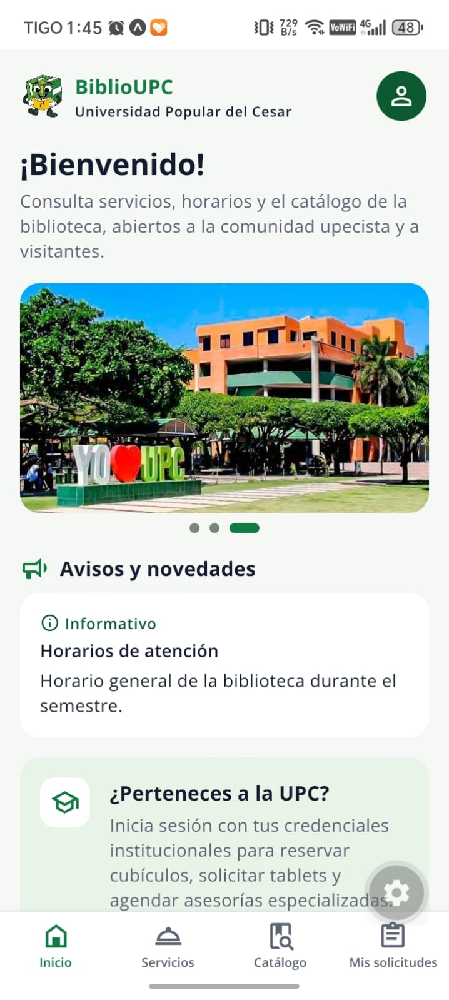

### El tutorial de Upecito

La primera vez que abres la aplicación en el celular, Upecito, la mascota de la Universidad, la presenta en seis pasos: **Servicios**, **Catálogo**, **Mis solicitudes** y el **menú**. Cada paso muestra cómo se ve esa parte y dónde la encuentras: en qué pestaña de abajo o, el menú, arriba a la derecha. Usa **Siguiente** y **Atrás** para recorrerlo, o **Saltar** para cerrarlo. Al terminar, toca **Empezar**. Si tienes una sesión abierta que todavía no aceptó la autorización de datos personales, el tutorial aparece después de aceptarla.

El tutorial no vuelve a salir solo. Para verlo otra vez, toca el botón de arriba a la derecha y elige **Ver tutorial**, con sesión o sin ella.

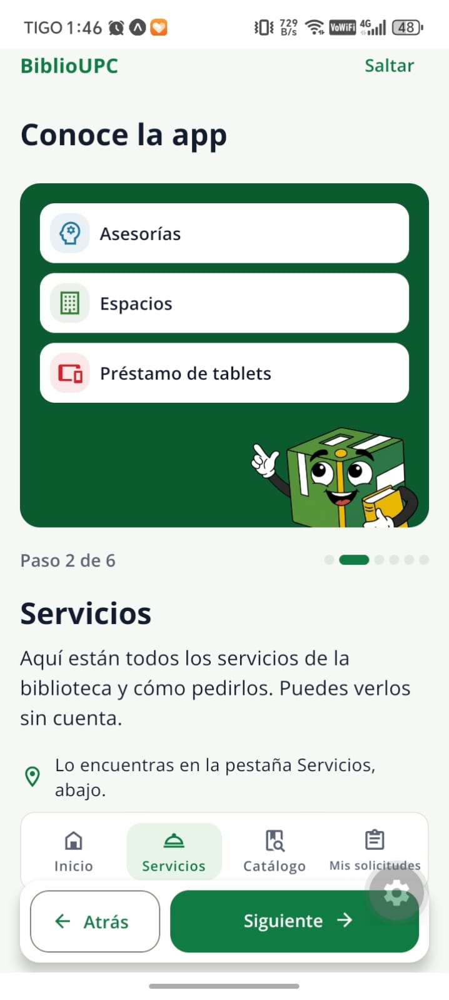

### La app conectada a la biblioteca

La app usa los mismos datos que el portal web de la biblioteca: los servicios, los avisos, las guías, los espacios y tus solicitudes son los reales, y lo que haces en la app también se ve en la web.

- **Mientras carga**, la pantalla muestra la forma de lo que va a aparecer, en gris.
- **El servidor descansa cuando nadie lo usa.** La primera vez que abres la app en un rato, puede tardar hasta un minuto; mientras tanto aparece «Conectando con la biblioteca. La primera vez puede tardar hasta un minuto.».
- **Sin internet o si el servidor no responde**, la pantalla lo dice y ofrece **Reintentar**. La app no inventa datos: las guías que guardaste sí se abren sin conexión.

## 2. Sin cuenta

Cualquier persona puede usar estas partes sin iniciar sesión. Abajo están las pestañas **Inicio**, **Servicios**, **Catálogo** y **Mis solicitudes**.

1. **Inicio:** las fotos de la biblioteca, los **Avisos y novedades** y los servicios destacados. Toca uno para ver su detalle. Si la biblioteca no ha publicado fotos, Upecito te da la bienvenida en su lugar.
2. **Servicios:** todos los servicios con su público, horarios y forma de solicitud.
3. **Catálogo:**
   - **Catálogo de la biblioteca:** libros, revistas y tesis de la biblioteca.
   - **Repositorio institucional:** trabajos de grado e investigaciones de la Universidad, en texto completo.
   - **Bibliotecas en línea:** las bases de datos y bibliotecas digitales de la Universidad. Arriba se puede buscar por nombre o tema (por ejemplo, "enfermería") y filtrar por área.
   - **Guías de la biblioteca:** las guías en PDF y las escritas se abren una vez con internet y quedan guardadas en el celular para leerlas sin conexión. **Abrir guía** abre el PDF con el lector de PDF del celular. Las guías con enlace (Drive o una página web) necesitan internet siempre.
4. **Autoarchivo:** desde el servicio **Depósito de trabajos de grado** o desde **Catálogo → Repositorio**, los pasos del instructivo de la biblioteca para depositar tu trabajo de grado: crear tu cuenta del repositorio, pedir acceso a la colección de tu programa, los formatos y los datos que te pedirán. **Descargar instructivo (PDF)** abre el instructivo completo, con capturas del repositorio, e **Ir al repositorio** te lleva a depositar.

## 3. Comunidad con cuenta

### Crear una cuenta

Si eres estudiante, docente o administrativo de la Universidad y todavía no tienes usuario:

1. Toca el botón de arriba a la derecha, elige **Iniciar sesión** y, debajo del formulario, toca **Regístrate**.
2. Escribe tus nombres, tus apellidos, tu número de cédula y tu correo institucional (`@unicesar.edu.co`). El celular es opcional. Bajo cada campo hay una ayuda corta, por ejemplo «Solo números, sin puntos ni espacios».
3. Elige si eres **Estudiante**, **Docente** o **Administrativo**, y tu sede (**Valledupar** o **Aguachica**; obligatoria si eres estudiante). Si eres estudiante, elige tu facultad y tu programa en las listas (si no está, elige **Otro programa** y escríbelo) y tu semestre; si estás en el 11.º o más, elige **Otro** y ajusta el número. Si eres docente o administrativo, puedes escribir tu dependencia. Los coordinadores, directores y decanos se registran como docente o administrativo.
4. Escribe una contraseña de al menos 8 caracteres, que no sea solo números, y repítela.
5. Toca **Leer la autorización**: se abre en una ventana el formato del Acuerdo 019, con el enlace a la política; **Acepto** marca la casilla. Luego toca **Crear cuenta**. Esa aceptación queda guardada en tu cuenta: no se vuelve a pedir al iniciar sesión.

La aplicación inicia tu sesión y te lleva a Inicio. Tus datos ya aparecen al pedir un servicio. Si el correo o la cédula ya tienen una cuenta, el mensaje aparece bajo ese campo. El registro es solo para la comunidad: los permisos del personal los da la administración de la biblioteca.

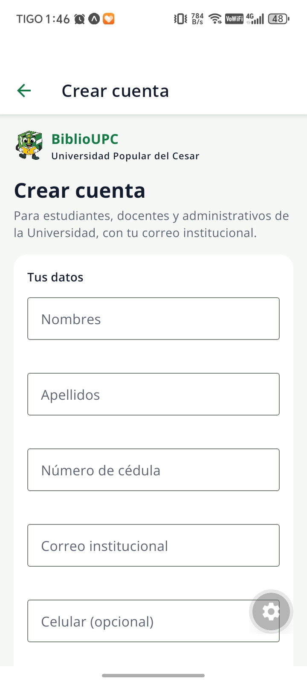
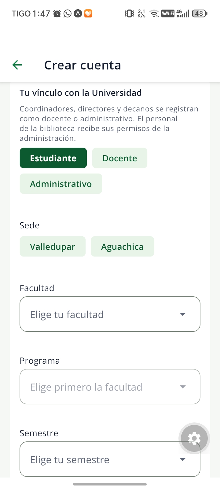
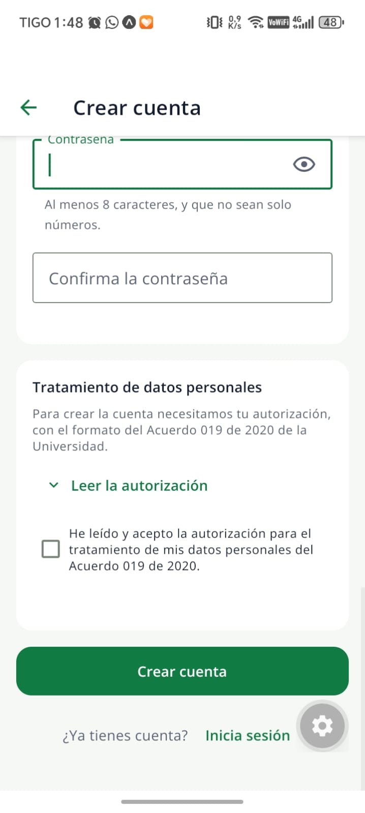
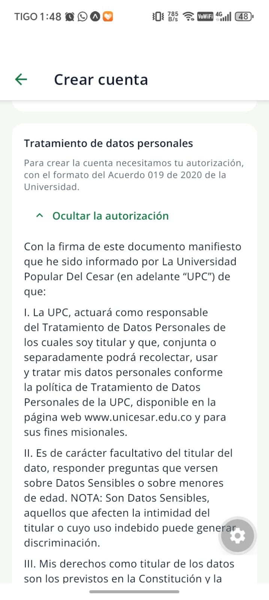

### Iniciar sesión

1. Toca el botón de arriba a la derecha y elige **Iniciar sesión**.
2. Escribe el usuario (por ejemplo, `laura.perez`) y la contraseña.
3. Toca **Iniciar sesión**.

Abajo, **Tratamiento de datos personales** abre la autorización y el enlace a la política.

La **autorización de tratamiento de datos personales** (Acuerdo 019 de la Universidad) se acepta al crear la cuenta y queda guardada en ella. Solo se vuelve a pedir al iniciar sesión si la Universidad publica una política nueva: en ese caso, léela, marca **He leído y acepto…** y toca **Aceptar y continuar**. Si tocas **No acepto**, se cierra la sesión y puedes seguir explorando la app sin cuenta.

En **Perfil** y en el formulario de datos de contacto siempre está el enlace **Tratamiento de datos personales**, y el formulario dice para qué se usa el teléfono. En Perfil también aparecen el NIT de la Universidad y los plazos para ejercer tus derechos: 10 días hábiles para consultas y 15 para reclamos.

Para ejercer esos derechos, escribe al correo **tratamientodedatos@unicesar.edu.co**, como indica el Acuerdo 019.

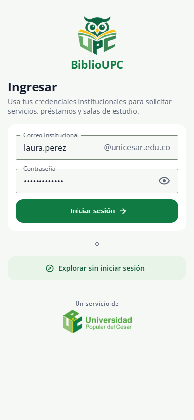

### Cómo se llenan las solicitudes

Las solicitudes de espacios, asesorías y capacitaciones se llenan en tres pasos. Arriba dice en cuál vas ("Paso 1 de 3").

1. **Solicitud:** lo que pides. **Siguiente** revisa ese paso: si falta algo, el error sale bajo el campo y no avanza.
2. **Tus datos:** vienen de tu cuenta (nombre, correo, celular y, si eres estudiante, tus datos académicos). Corrige lo que haga falta.
3. **Términos:** léelos y marca **He leído y acepto los términos y condiciones**. Solo entonces se habilita **Enviar solicitud**.

Con **Anterior** vuelves a un paso sin perder lo que escribiste.

### Solicitar un espacio

Solo pueden reservar docentes y administrativos.

1. En **Servicios**, abre **Reserva de espacios** y toca **Ver disponibilidad**.
2. Elige un espacio y un día en el calendario. Los días sin atención salen tachados.
3. Toca una franja libre. En el primer paso, completa el propósito, la cantidad de asistentes y los **recursos de apoyo** que necesitas (portátil, cable HDMI, cable de red, mouse o marcadores; o **No requiere**), y si quieres, las novedades.
4. Sigue con **Tus datos** y **Términos**, y toca **Enviar solicitud**. Si el horario ya está ocupado, la aplicación te muestra los horarios libres para elegir otro.

La reserva queda **Pendiente** hasta que la biblioteca la apruebe.

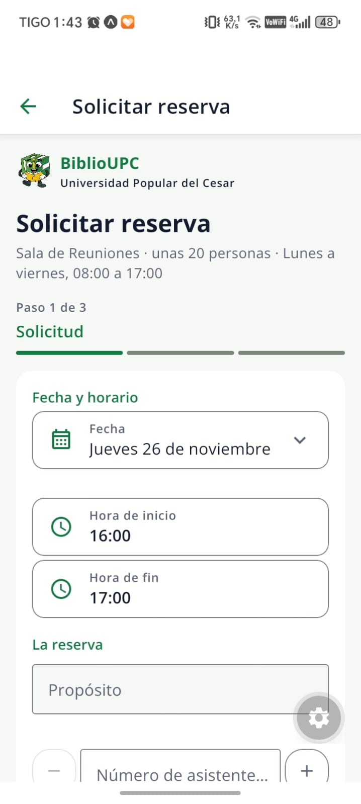
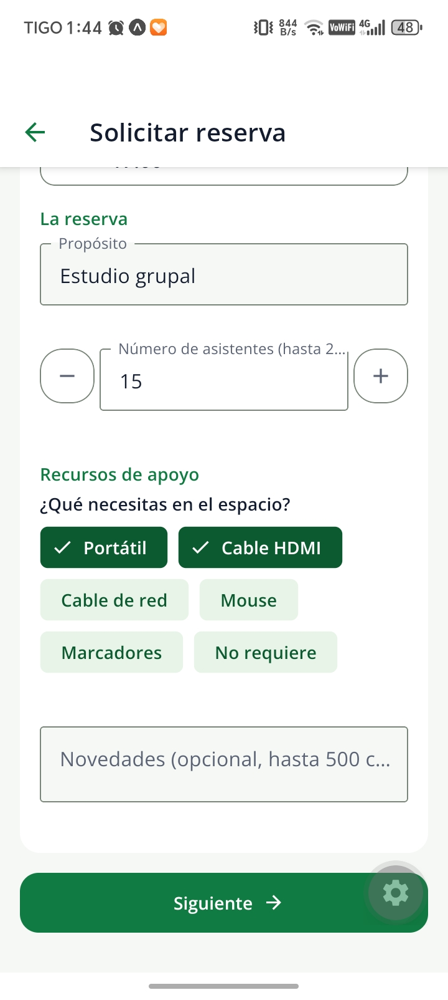

### Solicitar una asesoría

1. En **Servicios**, abre **Asesorías especializadas** y elige un tema. Hace falta iniciar sesión.
2. En el primer paso, elige la fecha y la hora que te sirven (con al menos 72 horas de anticipación y dentro del horario de atención; el calendario tacha los días que no se pueden), la modalidad, cuántas personas asisten (hasta 5, con el nombre de cada una) y qué necesitas.
3. Sigue con **Tus datos** y **Términos**, y toca **Enviar solicitud**.

Tu solicitud queda **Pendiente** hasta que la biblioteca la apruebe: al aprobarla confirma la fecha y la hora (puede cambiarlas) y asigna quién te atiende. Te llega una notificación; si la rechazan, el aviso trae el motivo. Si la biblioteca cambió la fecha, **Mis citas** y el detalle en **Mis solicitudes** muestran también la que pediste. En una asesoría virtual aprobada, **Abrir enlace** te lleva a la reunión. Si la biblioteca no ha fijado cuánto dura una asesoría, la cita muestra solo la hora de inicio.

Las citas se pueden cancelar o reprogramar desde **Mis citas** o desde su detalle en **Mis solicitudes**: las pendientes en cualquier momento y las aprobadas hasta el plazo que fija la biblioteca. Para reprogramar solo eliges otra fecha y otra hora: se envía una solicitud nueva, que queda **Pendiente**, y la anterior queda cancelada.

El día de la asesoría aprobada, desde 30 minutos antes, **Mis citas** y el detalle en **Mis solicitudes** muestran **Registrar asistencia**. Tócalo y escanea el código QR que te muestra el facilitador: la aplicación confirma que quedó registrada. Si el código venció o es de otra sesión, te dice el motivo y puedes escanear otra vez. La primera vez, la aplicación pide permiso para usar la cámara; solo la usa para leer el código.

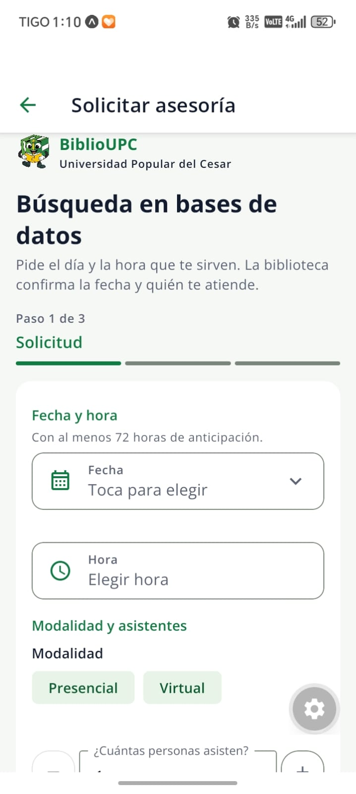

### Pedir una tablet

1. En **Servicios**, abre **Préstamo de tablets** y toca **Solicitar tablet**.
2. Elige el día (con hasta 7 días de anticipación) y la hora de inicio, en punto o y media. Si no hay tablets, la aplicación sugiere otras horas.
3. Elige por cuántas horas la necesitas, de 1 a 4 (empieza en 3). La aplicación muestra la hora de devolución.
4. Revisa tus datos (vienen de tu cuenta; si eres estudiante, también la sede, la facultad y el programa). Marca que aceptas las **condiciones de uso** y la **responsabilidad sobre el préstamo**: **Leer las condiciones** y **Leer las notas** abren cada texto en una ventana, con **Acepto**. Toca **Confirmar solicitud**.

La tablet se recoge en el mostrador de la biblioteca. Allí te asignan la tablet y firmas la constancia en la pantalla del celular de la biblioteca (o en papel, si lo prefieres).

- Si no la recoges dentro de la **hora siguiente** a la hora de inicio, el préstamo se cancela y te llega un aviso.
- No puedes tener dos préstamos de tablet que se crucen en las mismas horas.

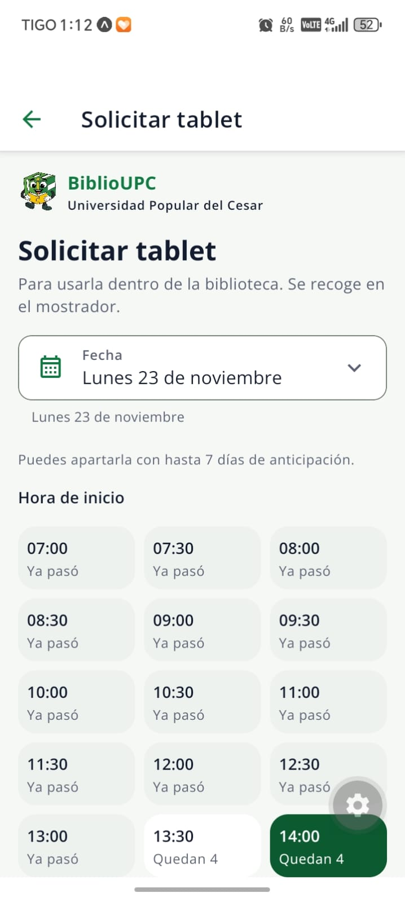
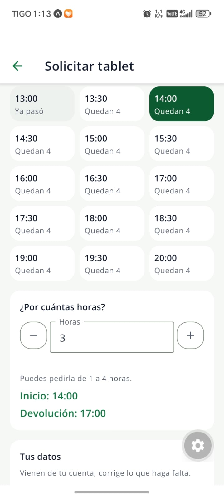

### Solicitar una capacitación

1. En **Servicios**, abre **Capacitaciones** y toca **Solicitar capacitación**.
2. En el primer paso, elige la línea de formación, la modalidad, la fecha y la hora.
3. Escribe la **asignatura y el grupo** (por ejemplo, "Bases de datos, 7.º semestre, grupo 02"), cuántas personas asistirán, el objetivo y, si quieres, las novedades.
4. Sigue con **Tus datos** y **Términos**, y toca **Enviar solicitud**.

Si la fecha no es un día hábil, la aplicación lo dice y sugiere otra.

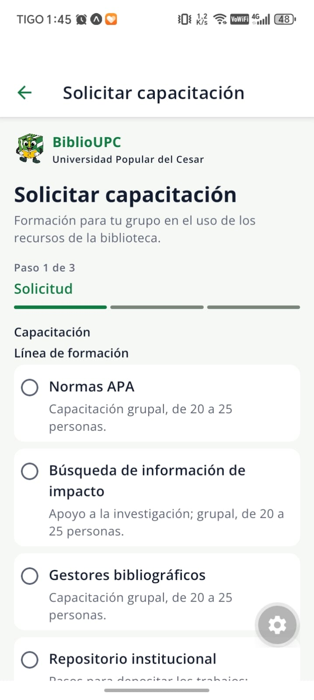
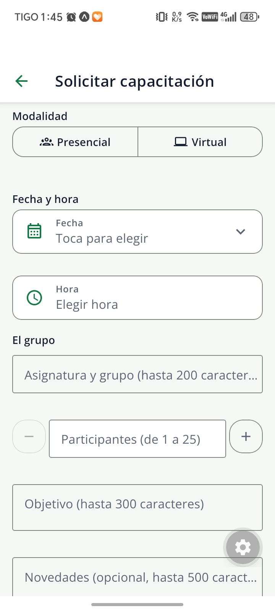

### Mis solicitudes y Mi calendario

1. La pestaña **Mis solicitudes** muestra las reservas, asesorías, préstamos y capacitaciones con su estado: Pendiente, Aprobada, Rechazada, Nueva fecha propuesta, Cancelada o Finalizada. Toca una para ver su detalle y su historial.
2. Si la biblioteca propone otro día, la solicitud dice **Nueva fecha propuesta**. Ábrela y toca **Aceptar la nueva fecha**, o **No me sirve** para cancelar la solicitud.
3. Las asesorías y capacitaciones finalizadas que todavía no calificaste dicen **Por calificar**. Ábrela y, en **¿Cómo te pareció?**, elige de 1 a 5 estrellas (de Malo a Excelente), escribe un comentario si quieres y toca **Enviar**. Solo se califica una vez; después, el detalle muestra tu calificación.
4. En el detalle de una solicitud que se pueda cancelar, toca **Cancelar solicitud** y confirma.
   En capacitación debes escribir el motivo. Las reservas pendientes y las tablets reservadas
   se cancelan antes del inicio, y las reservas y capacitaciones aprobadas hasta el plazo de la
   biblioteca. Las capacitaciones pendientes o con fecha propuesta se pueden cancelar en
   cualquier momento.
5. En el menú de arriba a la derecha:
   - **Mi calendario** muestra por día las citas, las reservas y los préstamos, y envía recordatorios antes de cada uno.
   - **Notificaciones** muestra los avisos de cada cambio. Usa **Marcar todas como leídas** si hay avisos sin leer.

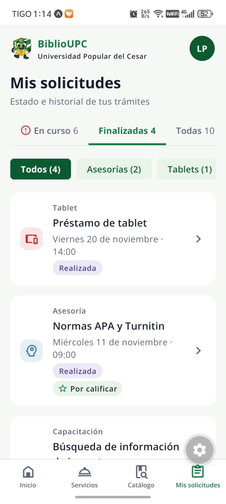
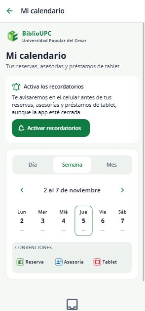

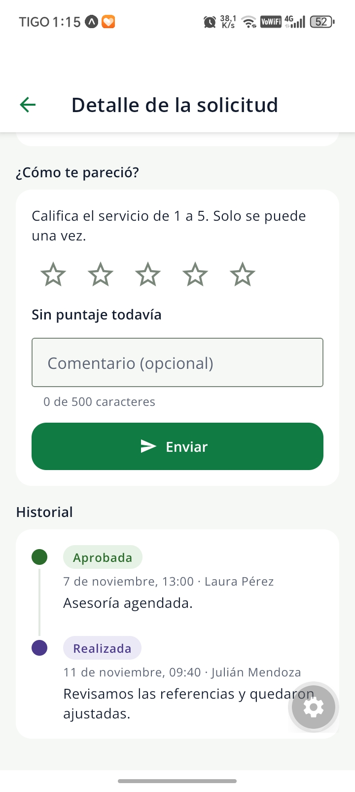

## 4. Personal de la biblioteca

Al iniciar sesión con una cuenta del personal, abajo aparecen las pestañas **Dashboard**, **Gestión**, **Personal**, **Inventario** y **Estadísticas**. Cada persona ve solo lo que le corresponde a su rol. Para ver la aplicación como la comunidad, usa **Ver la vista de la comunidad** en el menú de arriba a la derecha.

La primera vez que alguien del personal entra en el celular, Upecito le muestra su vista: **Gestión**, con las secciones que tiene, y, según su rol, **Personal**, **Inventario** y **Estadísticas**, además del menú. Cada paso dice en qué pestaña está. Para verlo otra vez, desde la vista del personal, toca el botón de arriba a la derecha y elige **Ver tutorial**.

### Dashboard

Es lo primero que se ve al entrar. Muestra el día de cada persona, según sus permisos:

1. **Las cifras del día:** cuántas solicitudes esperan respuesta (**Por revisar**), cuántas están aprobadas para hoy (**Para hoy**) y, para quien maneja el préstamo de tablets, cuántas están **prestadas**.
2. **Resumen de hoy:** una tarjeta por área (**Reservas de espacios**, **Asesorías**, **Capacitaciones** y **Tablets**) con lo que hay por revisar y lo de hoy. Al tocarla, se abre su sección en **Gestión**; la de tablets abre **Préstamos** en **Vencidos** si hay préstamos vencidos.
3. **Por atender:** las solicitudes pendientes, la más próxima primero, con chips para ver solo un tipo. Al tocar una se abre su detalle para aprobarla o rechazarla; las reservas se abren en **Gestión → Solicitudes**. **Ver todo** lleva a la bandeja completa.
4. **Afluencia semanal:** para quien tiene el permiso de estadísticas, cuántas operaciones hay en promedio cada día de la semana en las últimas 8 semanas y cuál es el día de más uso.

Para actualizarlo, desliza hacia abajo; también se actualiza solo al volver a la pestaña.

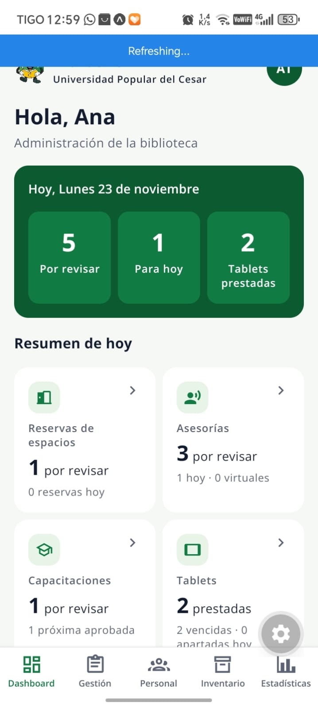
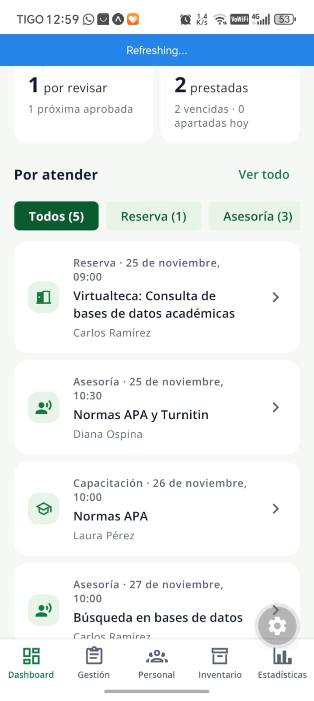
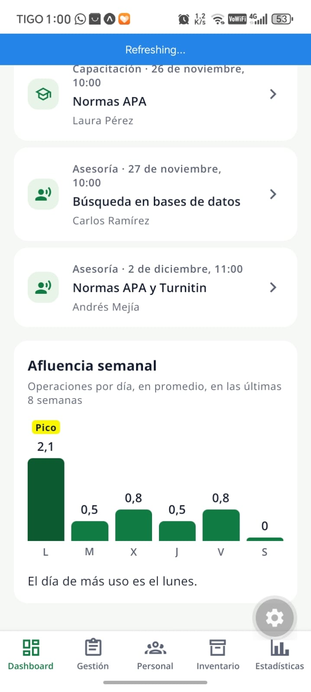

### Gestión

1. **Solicitudes:** las solicitudes que llegan de la comunidad. Arriba, el selector **Reservas · Capacitaciones** elige cuáles ver.
   - Toca **Aprobar** para aceptar una.
   - Toca **Rechazar** para negarla; pide el motivo.
   - Toca **Otra fecha** para proponer otro día u hora.
   - En una capacitación aprobada, toca **Asignarme** o **Asignar responsable** para elegir quién la dicta y, cuando se haga, **Marcar como finalizada**.
   - El botón **Reservar para un tercero** reserva un espacio a nombre de otra persona: búscala en **Buscar por nombre, correo o identificación** (desde 3 caracteres) y elígela. Si tu cuenta no tiene permiso para buscar, escribe su correo institucional.
2. **Agenda:** las citas de asesoría por día, por semana y por mes. Las que esperan respuesta se ven como **Pendiente**, y desde el detalle de la cita se **aprueban** (eligiendo quién la atiende: la administración, que aparece primero, o un facilitador) o se **rechazan** con un motivo; rechazarla libera el cupo de esa franja. Desde una cita del día se puede **Tomar asistencia**: la aplicación muestra un código QR para la sesión y el facilitador marca a mano a quien asistió. Quien asiste también puede registrarse escaneando ese QR desde su aplicación. Con **Registrar a mano**, elige **Con cuenta** para buscar a la persona por nombre, correo o identificación, o **Sin cuenta** para escribir sus datos.
3. **Préstamos:** la entrega y la devolución de tablets. Si hay préstamos vencidos, la pestaña muestra cuántos con un aviso. Los chips separan los préstamos:
   - **Entregar:** los apartados. Toca **Registrar entrega**:
     1. Elige la tablet de la lista o toca **Escanear**. Solo aparecen las tablets libres durante todas las horas del préstamo; la tablet se asigna en este momento.
     2. Marca el estado y los accesorios, revisa la constancia con la persona y marca que acepta la responsabilidad.
     3. Toca **Firmar** y pásale el celular a la persona: firma con el dedo en una ventana a pantalla completa (**Borrar** para repetir) y toca **Listo**. Si prefiere firmar a mano, marca **Firmará en papel**.
     4. Toca **Registrar entrega**.
   - **Recibir:** las tablets prestadas que van a tiempo. Toca **Registrar devolución**, marca cómo llegó y los accesorios, escribe las novedades si hay daños o faltantes, y confirma: el préstamo se cierra.
   - **Vencidos:** las que pasaron la hora límite, con el aviso para contactar a las personas. Se reciben igual, con **Registrar devolución**.
   - **Historial:** lo devuelto, con el retraso y las novedades.
   - **Tu firma en las constancias:** regístrala una vez en **Perfil → Mi firma**. Se pone sola en el recuadro de quien entrega y de quien recibe; sin ella, la constancia dice que firmaste con tu cuenta.
   - **Constancia:** el formato de responsabilidad del préstamo. **Compartir constancia (PDF)** lo envía con el logo de la Universidad, la firma del usuario, la de quien entregó y quien recibió (con la firma registrada en su Perfil o, si no la tienen, con su cuenta) y un **código de verificación**. Si la persona firmó en papel, imprímelo y firma en el recuadro.
   - **Escanear tablet** (botón de abajo a la derecha): lee el código de barras con la cámara de la aplicación (la primera vez pide el permiso) o deja escribir el código. Si la tablet está prestada, abre su devolución; si está libre, muestra a quién se le puede entregar hoy.
   - Un préstamo apartado que no se recoge dentro de la hora siguiente a su inicio se cancela solo y libera la tablet.
4. **Portal:** en tres grupos. Cada persona ve solo las filas de sus permisos.
   - **Publicaciones** (lo que ve la comunidad):
     - **Contenidos del portal:** los avisos, novedades y servicios que ve la comunidad.
     - **Fotos de Inicio:** las fotos del carrusel que ve la comunidad al abrir la aplicación. **Nueva foto** abre la galería, recorta la foto a lo ancho y pide escribir qué muestra (eso es lo que lee el lector de pantalla). Con el menú **⋮** de cada foto se edita, se **sube** o se **baja** en el orden y se **publica** u **oculta**. Se publican hasta 5 a la vez. Si no hay ninguna publicada, o si no hay internet, Inicio muestra la bienvenida de Upecito.
     - **Guías de la biblioteca:** las guías que ve la comunidad en Catálogo. En **Cómo se lee** se elige el formato: **PDF** (con **Elegir PDF** se sube el archivo del celular, hasta 10 MB), **Enlace** (Drive o una página web) o **Escrita** (se escribe en la aplicación). Con el menú **⋮** de cada guía se edita y se **publica** u **oculta**.
   - **Servicios** (lo que se puede solicitar):
     - **Temas de asesoría:** los temas en los que la comunidad puede pedir una asesoría.
     - **Líneas de formación:** las capacitaciones que se ofrecen.
     - **Espacios:** crear y editar espacios (con **Nuevo espacio**, abajo a la derecha), activarlos o desactivarlos, y bloquearlos por mantenimiento o eventos.
   - **Configuración:**
     - **Parámetros generales:** periodos académicos, festivos, horarios de atención, tiempos mínimos para solicitar y cancelar, y textos automáticos.

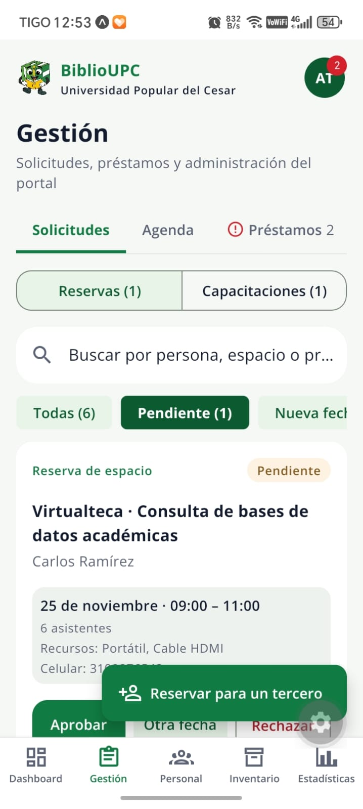
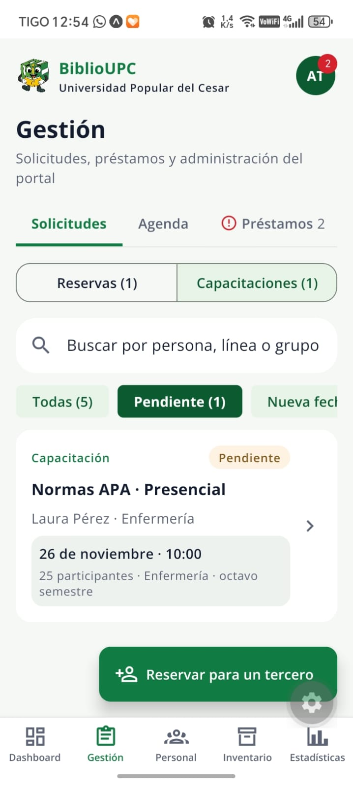
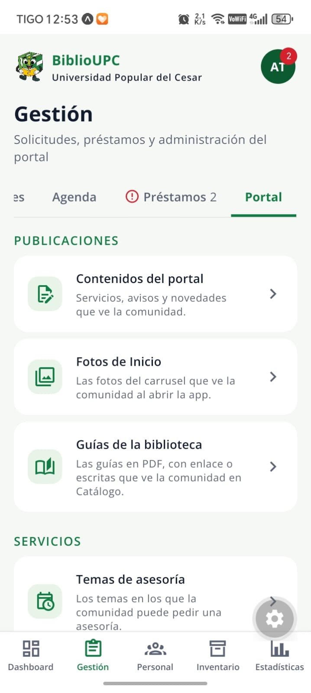
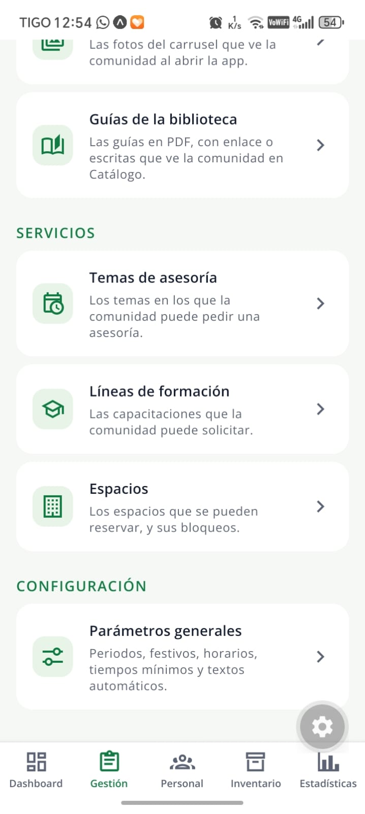
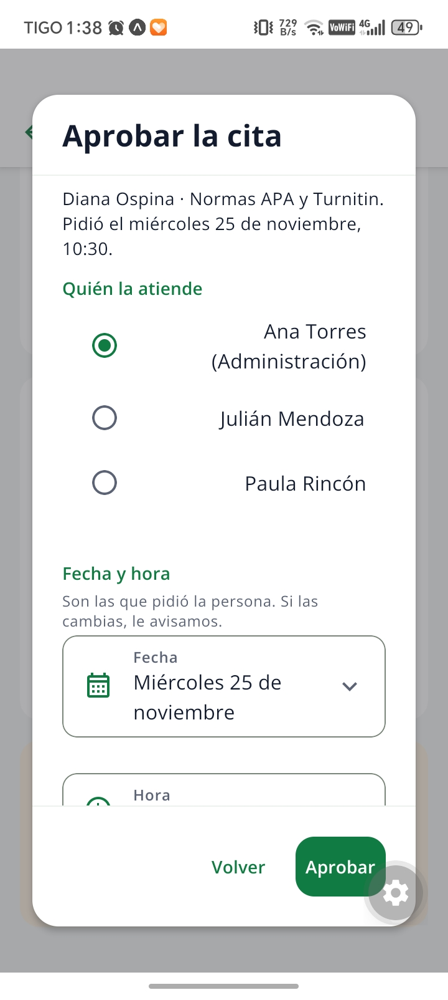
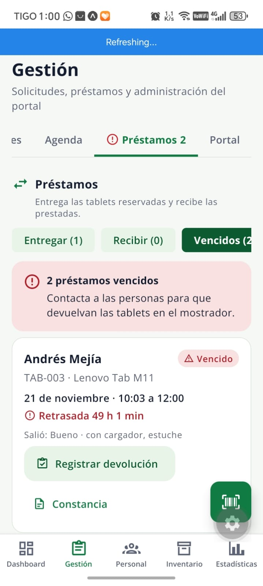
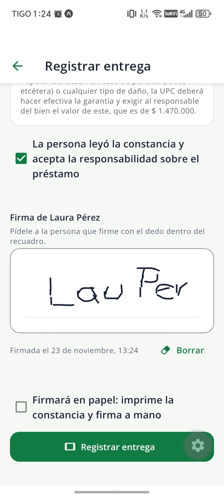
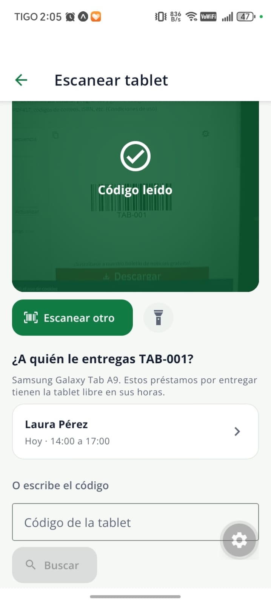
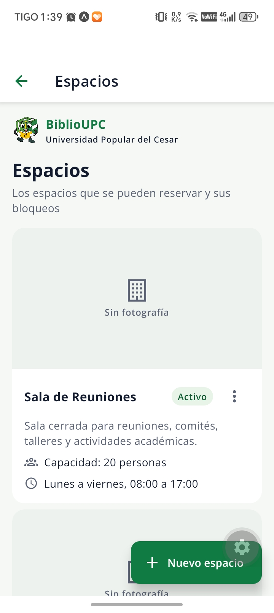

### Inventario

**Tablets** muestra cuántas tablets hay **Disponibles**, **En préstamo** y en **Mantenimiento**, y cada tablet con su código, modelo, marca, valor, serial, accesorios y estado. Arriba se busca por código, serial o modelo, y los chips filtran por estado.

- **Registrar tablet** (botón de abajo a la derecha) agrega una tablet nueva.
- El menú **⋮** de cada tarjeta tiene **Editar** y el cambio de estado: **Enviar a mantenimiento** y luego **Marcar disponible**. Una tablet prestada se recibe en **Gestión → Préstamos**.

En **Inventario → Incidencias** puedes buscar por préstamo, persona, tablet o descripción y
filtrar por tipo y fechas. Cada tarjeta indica qué pasó, cuándo y quién lo reportó.

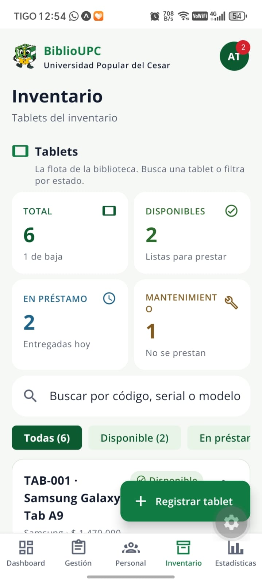
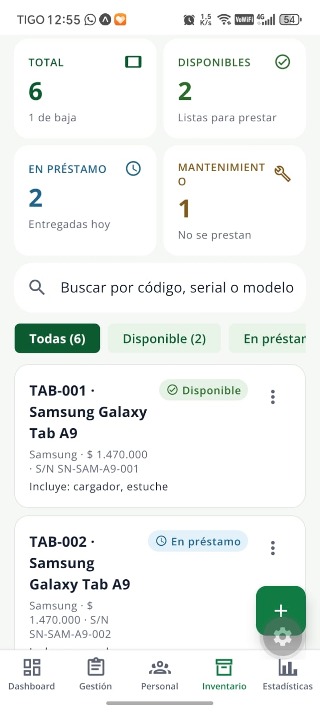

### Estadísticas

Arriba están las pestañas **Resumen**, **Servicios**, **Tablets**, **Calidad** y, con datos de prueba, **Registros**. Debajo, dos botones que valen para todas:

- **Filtros:** el periodo (con los atajos **Este mes**, **Este semestre** y **Todo**, o las fechas **Desde** y **Hasta**) y listas para elegir el servicio, el tipo de usuario, el programa, la facultad, la sede y el periodo académico. Cada opción dice cuántas operaciones tiene. Los filtros elegidos aparecen debajo de los botones; la **✕** de cada uno lo quita y **Limpiar** los quita todos.
- **Exportar.** Con la API puedes elegir **Excel (XLSX)**, **PDF** o **CSV**. El archivo respeta los filtros seleccionados. XLSX trae las hojas Resumen y Detalle, PDF trae el informe del Backend y CSV conserva el detalle con los indicadores al final. Con datos de prueba se ofrecen CSV y PDF generados en el celular.

En las tarjetas con dos vistas, toca el ícono de **dona**, **líneas** o **barras**. La app
recuerda la elección de cada tarjeta. La leyenda muestra los valores y porcentajes en texto.
Las comparaciones entre categorías usan barras y las cifras individuales se mantienen como tarjetas.

Qué muestra cada pestaña:

1. **Resumen:** el total de operaciones, el servicio más usado, las tasas de finalización, cancelaciones y rechazos, los asistentes por servicio y el último mes frente al anterior; los **hallazgos clave** (frases cortas con lo más llamativo) y las operaciones en el tiempo, **por mes** o **por semestre**.
2. **Servicios:** la demanda por servicio, cómo terminaron las solicitudes (finalizadas, canceladas y pendientes), presencial y virtual, los **temas de asesoría** y las **líneas de formación**, y quién usa los servicios: programa, tipo de usuario, facultad y sede.
3. **Tablets:** los préstamos, su duración promedio, cuántos duraron las horas de un préstamo normal (las de **Parámetros generales**) y cuántos se devolvieron sin la hora de entrega o de devolución; además, los préstamos por mes y por programa.
4. **Calidad:** la calificación promedio, las operaciones sin programa registrado y el **tiempo de respuesta**: cuánto tarda el personal, en promedio, en aprobar o rechazar una solicitud de cada servicio.
5. **Registros:** cada operación registrada, con quién la hizo, para qué, cuándo y cómo terminó, 10 por página. Lo que la persona no informó dice "No informado".

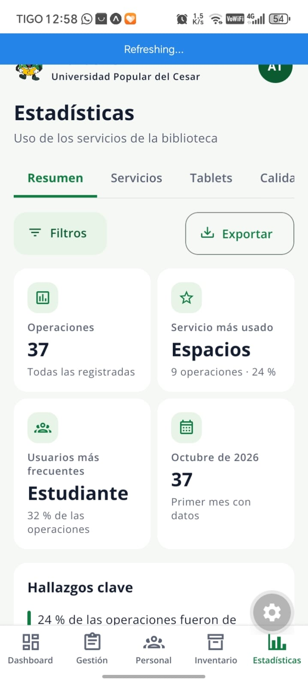
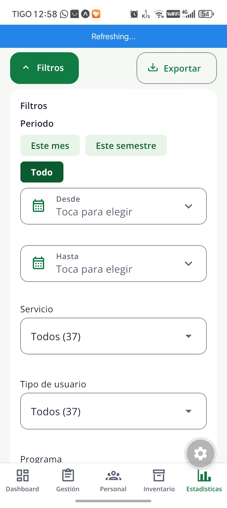
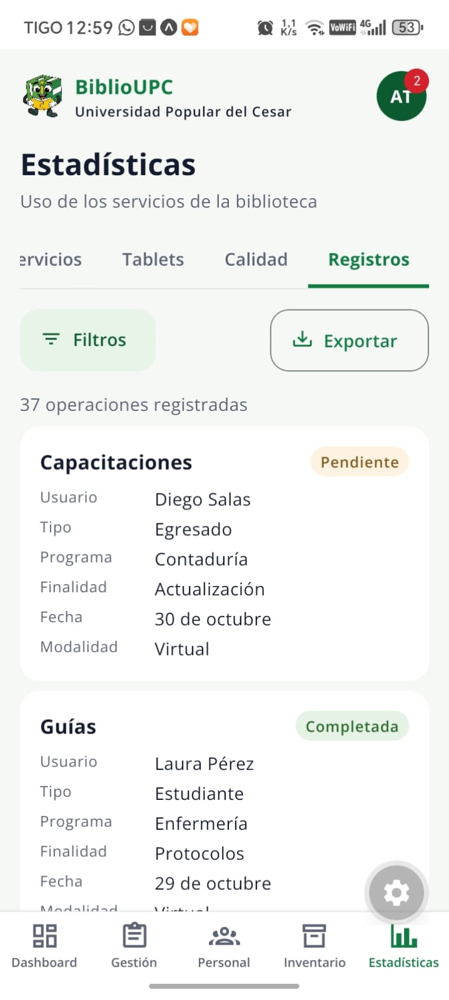

### Qué ve cada rol

- **Administración de la biblioteca:** todo, incluidas la pestaña **Personal** para asignar roles, **Parámetros generales**, y **Préstamos** (con los vencidos) e **Inventario** de tablets.
- **Facilitador:** las solicitudes de capacitación y la **Agenda** de sus asesorías.
- **Gestora de espacios:** las solicitudes de reserva y, en **Portal → Servicios**, los **Espacios**, con sus bloqueos.

**Permisos adicionales.** La administración puede encargar tres tareas a quien quiera del personal, sea facilitador o gestor de espacios. En **Personal**, toca **Roles y permisos** en la tarjeta de la persona y activa los que correspondan en **Permisos adicionales**:

- **Publicar novedades y avisos:** en **Portal**, los avisos y los informativos de Inicio y las **Guías de la biblioteca**, sin tocar los servicios.
- **Administrar las fotos de Inicio:** en **Portal**, las **Fotos de Inicio**.
- **Editar los parámetros generales:** en **Portal**, los **Parámetros generales**.

Solo se le pueden dar a alguien que tenga un rol del personal: a una cuenta de la comunidad no le servirían, porque no entra a esa vista. Si se le quitan todos los roles, también pierde estos permisos.

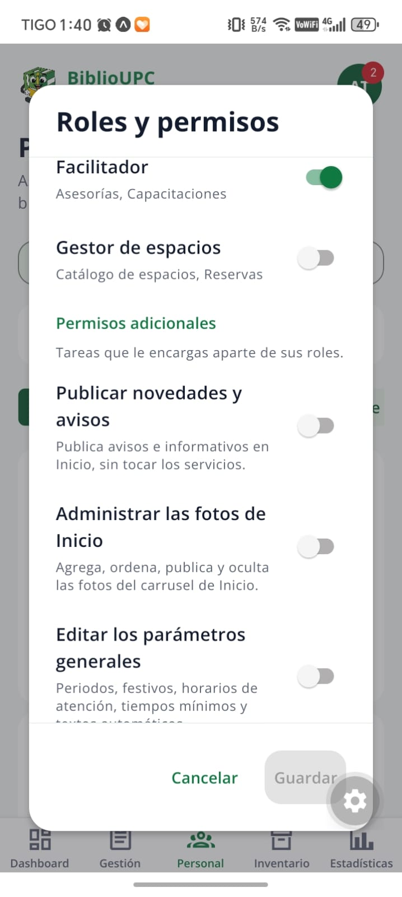

## 5. Usuarios de prueba

En la app conectada se entra con la cuenta institucional: la de la comunidad se crea con **Regístrate**, y la del personal la habilita la administración de la biblioteca.

Los usuarios de esta tabla existen **solo en el instalador de demostración**. Todos entran con la contraseña **`biblioteca123`**. Basta con escribir el usuario: la aplicación completa el correo institucional.

| Usuario          | Nombre         | Tipo de usuario | Rol en la biblioteca            |
| ---------------- | -------------- | --------------- | ------------------------------- |
| `laura.perez`    | Laura Pérez    | Estudiante      | —                               |
| `carlos.ramirez` | Carlos Ramírez | Docente         | —                               |
| `ana.torres`     | Ana Torres     | Administrativo  | Administración de la biblioteca |
| `julian.mendoza` | Julián Mendoza | Administrativo  | Facilitador                     |
| `sofia.vargas`   | Sofía Vargas   | Administrativo  | Gestora de espacios             |
| `mateo.castro`   | Mateo Castro   | Egresado        | —                               |

## 6. Limitaciones de esta versión

- **El servidor descansa:** si nadie usa la app un rato, la primera carga puede tardar hasta un minuto.
- **Egresados:** todavía no pueden crear su cuenta desde la app.
- **Notificaciones:** los avisos de cada cambio se ven en **Notificaciones**, dentro de la app, y los recordatorios de Mi calendario llegan al celular. Los avisos que manda el servidor con la app cerrada llegarán en una versión siguiente.
- **Catálogo:** la disponibilidad de los ejemplares se ve en la ficha del libro, en el catálogo de la biblioteca.
- **Instalador de demostración:** sus personas, solicitudes y estadísticas son de ejemplo, y lo que se cambia se borra al cerrar la aplicación.
- **Solo Android:** por ahora no hay versión para iPhone.
- **Cámara:** la lectura de códigos QR y de barras funciona solo en el celular.
