# Guía de uso de BiblioUPC

Guía corta para conocer la aplicación de la Biblioteca de la Universidad Popular del Cesar. Se lee en unos 10 minutos.

## 1. Qué es BiblioUPC y cómo instalarla

BiblioUPC reúne en el celular los servicios de la biblioteca: consultar el catálogo y las guías, reservar espacios, agendar asesorías, pedir una tablet o una capacitación, y seguir el estado de cada solicitud. El personal de la biblioteca atiende esas solicitudes desde la misma aplicación.

Para instalarla en un celular Android:

1. Descarga el instalador desde el enlace en el Release v1.0.0.
2. Abre el archivo descargado. Si el celular lo pide, permite instalar aplicaciones de esta fuente.
3. Toca **Instalar** y luego **Abrir**.

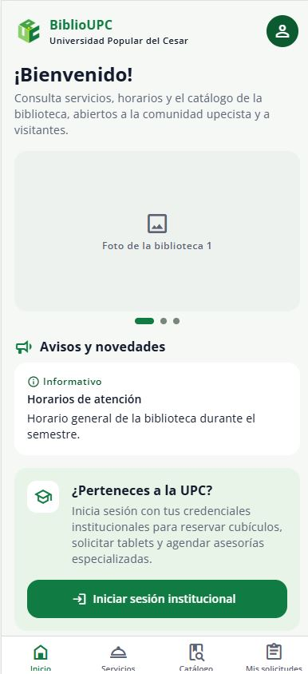

## 2. Sin cuenta

Cualquier persona puede usar estas partes sin iniciar sesión. Abajo están las pestañas **Inicio**, **Servicios**, **Catálogo** y **Mis solicitudes**.

1. **Inicio:** las fotos de la biblioteca, los **Avisos y novedades** y los servicios destacados. Toca uno para ver su detalle.
2. **Servicios:** todos los servicios con su público, horarios y forma de solicitud.
3. **Catálogo:**
   - **Catálogo de la biblioteca:** libros, revistas y tesis de la biblioteca.
   - **Repositorio institucional:** trabajos de grado e investigaciones de la Universidad, en texto completo.
   - **Recursos en línea:** las bases de datos académicas.
   - **Guías de la biblioteca:** se abren una vez con internet y quedan guardadas para leerlas sin conexión.
4. **Autoarchivo:** desde el servicio **Depósito de trabajos de grado**, los pasos para preparar el archivo y entrar al repositorio.

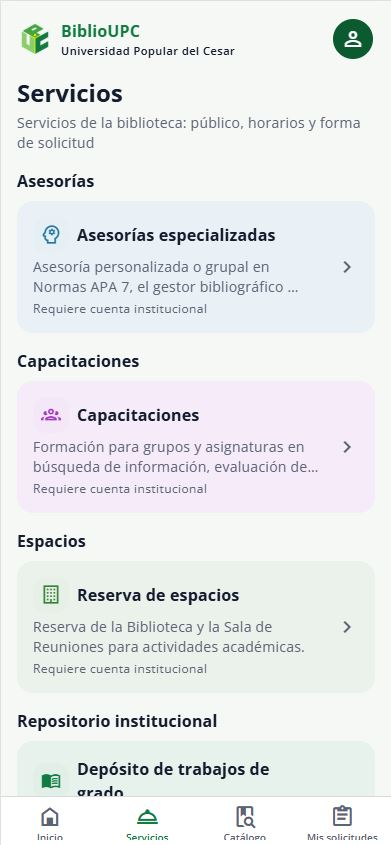
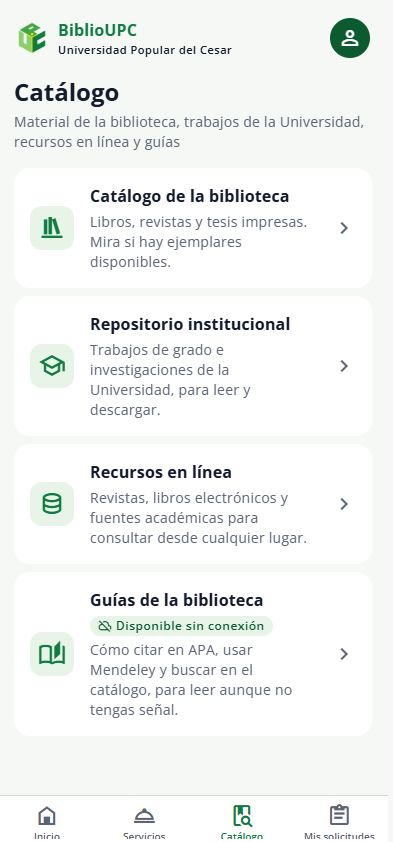

## 3. Comunidad con cuenta

### Iniciar sesión

1. Toca el botón de arriba a la derecha y elige **Iniciar sesión**.
2. Escribe el usuario (por ejemplo, `laura.perez`) y la contraseña.
3. Toca **Iniciar sesión**.

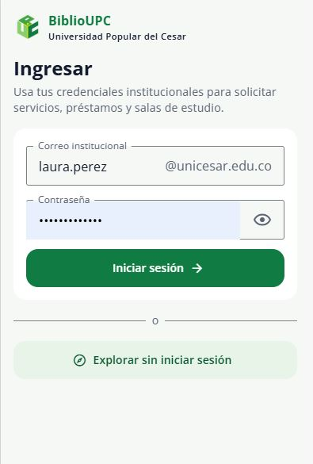

### Solicitar un espacio

1. En **Servicios**, abre **Reserva de espacios** y toca **Ver disponibilidad**.
2. Elige un espacio y un día en el calendario. Los días sin atención salen tachados.
3. Toca una franja libre, completa el propósito y la cantidad de asistentes, y toca **Solicitar reserva**.

La reserva queda **Pendiente** hasta que la biblioteca la apruebe.

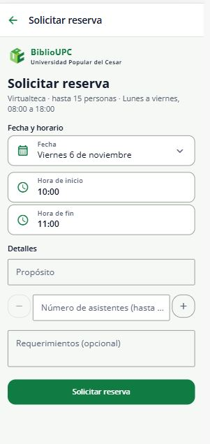

### Agendar una asesoría

1. En **Servicios**, abre **Asesorías especializadas** y elige un tema.
2. Elige el día y una franja libre.
3. Escribe qué necesitas y toca **Confirmar**.

Las citas se pueden cancelar o reprogramar desde **Mis citas**, dentro del plazo.

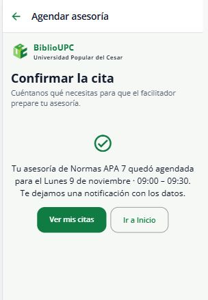

### Pedir una tablet

1. En **Servicios**, abre **Préstamo de tablets** y toca **Solicitar tablet**.
2. Elige el día y la hora. Si no hay tablets, la aplicación sugiere otras horas.
3. Acepta las condiciones de uso y toca **Confirmar solicitud**.

La tablet se recoge en el mostrador de la biblioteca.

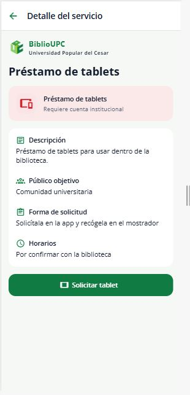

### Solicitar una capacitación

1. En **Servicios**, abre **Capacitaciones** y toca **Solicitar capacitación**.
2. Elige la línea de formación, la modalidad, la fecha y la hora.
3. Escribe el objetivo, el grupo y cuántas personas asistirán, y toca **Enviar solicitud**.

Si la fecha no es un día hábil, la aplicación lo dice y sugiere otra.

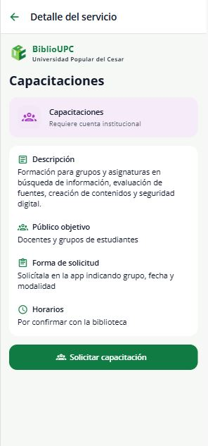

### Mis solicitudes y Mi calendario

1. La pestaña **Mis solicitudes** muestra las reservas, asesorías, préstamos y capacitaciones con su estado: Pendiente, Aprobada, Rechazada o Nueva fecha propuesta. Toca una para ver su detalle y su historial.
2. En el menú de arriba a la derecha:
   - **Mi calendario** muestra las citas y reservas por día.
   - **Notificaciones** muestra los avisos de cada cambio.

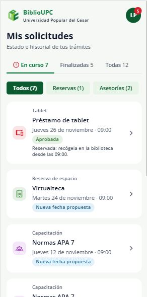
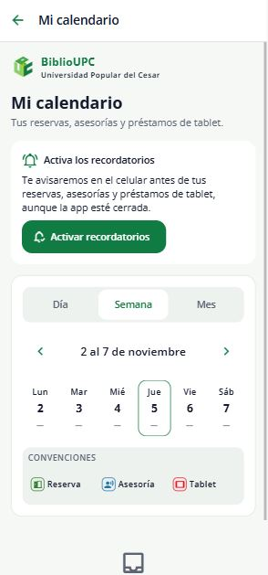

## 4. Personal de la biblioteca

Al iniciar sesión con una cuenta del personal, abajo aparecen las pestañas **Dashboard**, **Gestión**, **Personal**, **Inventario** y **Estadísticas**. Cada persona ve solo lo que le corresponde a su rol. Para ver la aplicación como la comunidad, usa **Ver la vista de la comunidad** en el menú de arriba a la derecha.

### Gestión

1. **Solicitudes:** las solicitudes que llegan de la comunidad.
   - Toca **Aprobar** para aceptar una.
   - Toca **Rechazar** para negarla; pide el motivo.
   - Toca **Otra fecha** para proponer otro día u hora.
   - El botón **Reservar para un tercero** reserva un espacio a nombre de otra persona.
2. **Agenda:** las citas de asesoría por día y por semana.
3. **Préstamos:** la entrega y la devolución de tablets, también leyendo el código de barras con la cámara.
4. **Vencidos:** las tablets que no se devolvieron a tiempo.
5. **Espacios:** crear y editar espacios, y bloquearlos por mantenimiento o eventos.
6. **Portal:**
   - **Contenidos del portal:** los avisos, novedades y servicios que ve la comunidad.
   - **Parámetros generales:** periodos académicos, festivos, horarios de atención, tiempos mínimos para solicitar y cancelar, y textos automáticos.
   - **Asesorías y jornadas:** los temas y los horarios de cada facilitador.
   - **Líneas de formación:** las capacitaciones que se ofrecen.

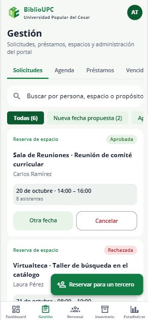
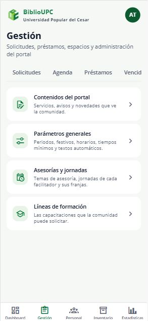

### Inventario

**Tablets** muestra cuántas tablets hay **Disponibles**, **En préstamo** y en **Mantenimiento**, y cada tablet con su estado. Desde la tarjeta de cada una se envía **A mantenimiento** y luego se vuelve a **Marcar disponible**.

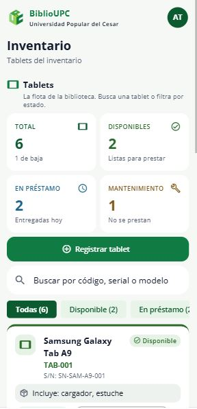

### Estadísticas

1. **Indicadores:** el total de operaciones y gráficos por servicio, mes, programa y tipo de usuario.
   - Se puede filtrar por periodo, servicio, tipo de usuario y programa.
   - **Exportar CSV** genera un archivo que se abre en Excel y lo comparte por correo, WhatsApp o Drive.
2. **Registros:** cada operación registrada, con quién la hizo, para qué, cuándo y cómo terminó. Lo que la persona no informó dice "No informado".

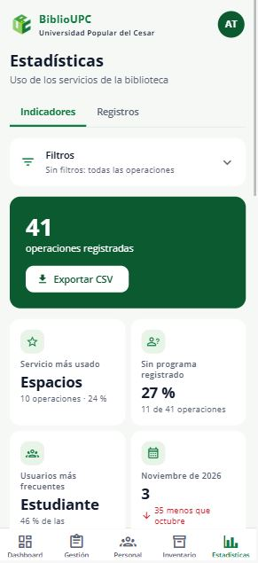
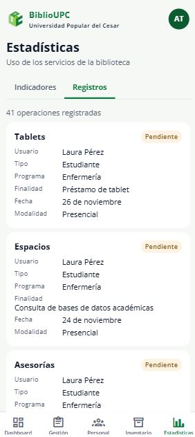

### Qué ve cada rol

- **Administración de la biblioteca:** todo, incluidas la pestaña **Personal**, para asignar roles, y **Parámetros generales**.
- **Facilitador:** las solicitudes de asesoría y capacitación, y la **Agenda** de sus citas.
- **Gestora de espacios:** las solicitudes de reserva y la sección **Espacios**, con sus bloqueos.
- **Encargado de préstamos:** **Préstamos**, **Vencidos** e **Inventario** de tablets.

## 5. Usuarios de prueba

Todos entran con la contraseña **`biblioteca123`**. Basta con escribir el usuario: la aplicación completa el correo institucional.

| Usuario | Nombre | Tipo de usuario | Rol en la biblioteca |
|---|---|---|---|
| `laura.perez` | Laura Pérez | Estudiante | — |
| `carlos.ramirez` | Carlos Ramírez | Docente | — |
| `ana.torres` | Ana Torres | Administrativo | Administración de la biblioteca |
| `julian.mendoza` | Julián Mendoza | Administrativo | Facilitador |
| `sofia.vargas` | Sofía Vargas | Administrativo | Gestora de espacios |
| `mateo.castro` | Mateo Castro | Administrativo | Encargado de préstamos (tablets) |

## 6. Limitaciones de esta versión

- **Datos de prueba:** todavía no está conectada a los sistemas de la Universidad. Las personas, solicitudes y estadísticas son de ejemplo, y lo que se cambia se borra al cerrar la aplicación.
- **Solo Android:** por ahora no hay versión para iPhone.
- **Notificaciones y cámara:** los recordatorios y la lectura de códigos QR y de barras funcionan solo en el celular.
