# Guía de uso de BiblioUPC

Guía corta para conocer la aplicación de la Biblioteca de la Universidad Popular del Cesar. Se lee en unos 10 minutos.

## 1. Qué es BiblioUPC y cómo instalarla

BiblioUPC reúne en el celular los servicios de la biblioteca: consultar el catálogo y las guías, reservar espacios, agendar asesorías, pedir una tablet o una capacitación, y seguir el estado de cada solicitud. El personal de la biblioteca atiende esas solicitudes desde la misma aplicación.

Para instalarla en un celular Android:

1. Descarga el instalador desde el enlace en el Release v1.0.0.
2. Abre el archivo descargado. Si el celular lo pide, permite instalar aplicaciones de esta fuente.
3. Toca **Instalar** y luego **Abrir**.

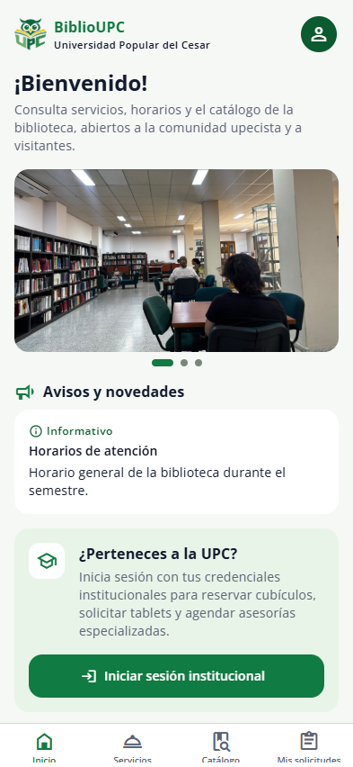

### El tutorial de Upecito

La primera vez que abres la aplicación en el celular, Upecito, la mascota de la Universidad, la presenta en seis pasos: **Servicios**, **Catálogo**, **Mis solicitudes** y el **menú**. Cada paso muestra cómo se ve esa parte y dónde la encuentras: en qué pestaña de abajo o, el menú, arriba a la derecha. Usa **Siguiente** y **Atrás** para recorrerlo, o **Saltar** para cerrarlo. Al terminar, toca **Empezar**. Si tienes una sesión abierta que todavía no aceptó la autorización de datos personales, el tutorial aparece después de aceptarla.

El tutorial no vuelve a salir solo. Para verlo otra vez, toca el botón de arriba a la derecha y elige **Ver tutorial**, con sesión o sin ella.

## 2. Sin cuenta

Cualquier persona puede usar estas partes sin iniciar sesión. Abajo están las pestañas **Inicio**, **Servicios**, **Catálogo** y **Mis solicitudes**.

1. **Inicio:** las fotos de la biblioteca, los **Avisos y novedades** y los servicios destacados. Toca uno para ver su detalle.
2. **Servicios:** todos los servicios con su público, horarios y forma de solicitud.
3. **Catálogo:**
   - **Catálogo de la biblioteca:** libros, revistas y tesis de la biblioteca.
   - **Repositorio institucional:** trabajos de grado e investigaciones de la Universidad, en texto completo.
   - **Bibliotecas en línea:** las bases de datos y bibliotecas digitales de la Universidad. Arriba se puede buscar por nombre o tema (por ejemplo, "enfermería") y filtrar por área.
   - **Guías de la biblioteca:** se abren una vez con internet y quedan guardadas para leerlas sin conexión.
4. **Autoarchivo:** desde el servicio **Depósito de trabajos de grado**, los pasos para preparar el archivo y entrar al repositorio.

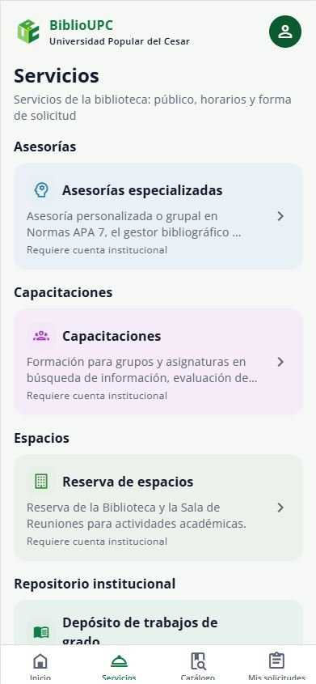
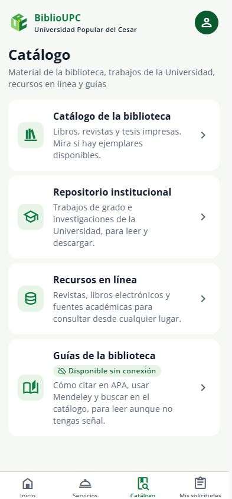

## 3. Comunidad con cuenta

### Crear una cuenta

Si eres estudiante, docente o administrativo de la Universidad y todavía no tienes usuario:

1. Toca el botón de arriba a la derecha, elige **Iniciar sesión** y, debajo del formulario, toca **Regístrate**.
2. Escribe tus nombres, tus apellidos, tu número de cédula y tu correo institucional (`@unicesar.edu.co`). El celular es opcional.
3. Elige si eres **Estudiante**, **Docente** o **Administrativo**. Si eres estudiante, escribe tu programa y elige tu semestre; si estás en el 11.º o más, elige **Otro** y ajusta el número. Si eres docente o administrativo, puedes escribir tu dependencia. Los coordinadores, directores y decanos se registran como docente o administrativo.
4. Escribe una contraseña de al menos 8 caracteres, que no sea solo números, y repítela.
5. Toca **Leer la autorización** para ver el formato del Acuerdo 019, marca **He leído y acepto…** y toca **Crear cuenta**.

La aplicación inicia tu sesión y te lleva a Inicio. Tus datos ya aparecen al pedir un servicio. Si el correo o la cédula ya tienen una cuenta, el mensaje aparece bajo ese campo. El registro es solo para la comunidad: los permisos del personal los da la administración de la biblioteca.

### Iniciar sesión

1. Toca el botón de arriba a la derecha y elige **Iniciar sesión**.
2. Escribe el usuario (por ejemplo, `laura.perez`) y la contraseña.
3. Toca **Iniciar sesión**.
4. La primera vez en este celular, la aplicación muestra la **autorización de tratamiento de datos personales**, con el texto del Acuerdo 019 de la Universidad (puntos I a VI). Léela, marca la casilla **He leído y acepto…** y toca **Aceptar y continuar**. El enlace **Tratamiento de datos personales** abre la política completa.

Si tocas **No acepto**, se cierra la sesión y puedes seguir explorando la app sin cuenta. La aceptación queda guardada para tu usuario: no se vuelve a pedir, salvo que la Universidad publique una política nueva.

En **Perfil** y en el formulario de datos de contacto siempre está el enlace **Tratamiento de datos personales**, y el formulario dice para qué se usa el teléfono. En Perfil también aparecen el NIT de la Universidad y los plazos para ejercer tus derechos: 10 días hábiles para consultas y 15 para reclamos.

Para ejercer esos derechos hay dos caminos, los dos del Acuerdo 019: el correo **tratamientodedatos@unicesar.edu.co** y el botón **Ejercer mis derechos por PQRS**, que abre el módulo de peticiones y quejas de la Universidad.

### Solicitar un espacio

1. En **Servicios**, abre **Reserva de espacios** y toca **Ver disponibilidad**.
2. Elige un espacio y un día en el calendario. Los días sin atención salen tachados.
3. Toca una franja libre, completa el propósito y la cantidad de asistentes, y toca **Solicitar reserva**.

La reserva queda **Pendiente** hasta que la biblioteca la apruebe.

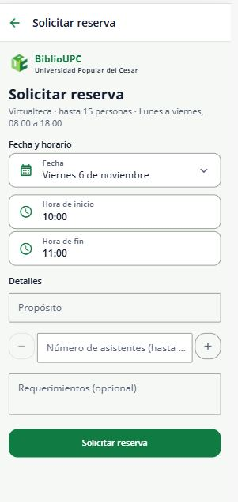

### Agendar una asesoría

1. En **Servicios**, abre **Asesorías especializadas** y elige un tema.
2. Elige el día y una franja libre.
3. Escribe qué necesitas y toca **Confirmar**.

Tu solicitud queda **Pendiente** hasta que el facilitador que la atiende o la administración la apruebe: el cupo se aparta desde el primer momento, así que nadie más puede tomarlo. Cuando la aprueben te llega una notificación; si la rechazan, el aviso trae el motivo.

Las citas se pueden cancelar o reprogramar desde **Mis citas**, dentro del plazo. Si las reprogramas, la cita vuelve a quedar **Pendiente** y hay que aprobarla otra vez.

El día de la asesoría aprobada, desde 30 minutos antes, **Mis citas** y el detalle en **Mis solicitudes** muestran **Registrar asistencia**. Tócalo y escanea el código QR que te muestra el facilitador: la aplicación confirma que quedó registrada. Si el código venció o es de otra sesión, te dice el motivo y puedes escanear otra vez. La primera vez, la aplicación pide permiso para usar la cámara; solo la usa para leer el código.

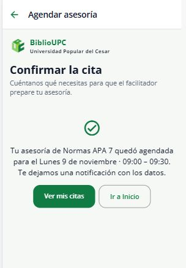

### Pedir una tablet

1. En **Servicios**, abre **Préstamo de tablets** y toca **Solicitar tablet**.
2. Elige el día (con hasta 7 días de anticipación) y la hora de inicio, en punto o y media. Si no hay tablets, la aplicación sugiere otras horas.
3. Elige por cuántas horas la necesitas, de 1 a 4 (empieza en 3). La aplicación muestra la hora de devolución.
4. Revisa tus datos, acepta las condiciones de uso y la responsabilidad sobre el préstamo, y toca **Confirmar solicitud**.

La tablet se recoge en el mostrador de la biblioteca.

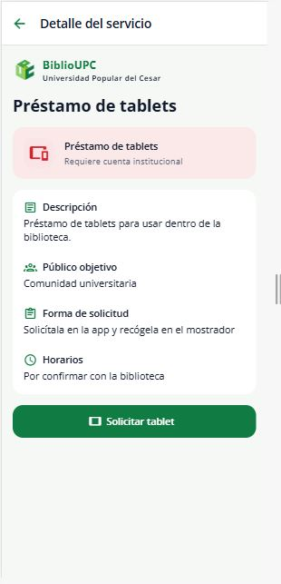

### Solicitar una capacitación

1. En **Servicios**, abre **Capacitaciones** y toca **Solicitar capacitación**.
2. Elige la línea de formación, la modalidad, la fecha y la hora.
3. Escribe el objetivo, el grupo y cuántas personas asistirán, y toca **Enviar solicitud**.

Si la fecha no es un día hábil, la aplicación lo dice y sugiere otra.

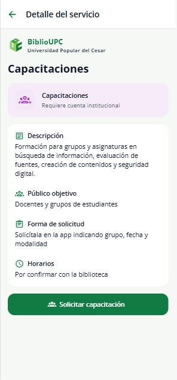

### Mis solicitudes y Mi calendario

1. La pestaña **Mis solicitudes** muestra las reservas, asesorías, préstamos y capacitaciones con su estado: Pendiente, Aprobada, Rechazada, Nueva fecha propuesta, Cancelada o Realizada. Toca una para ver su detalle y su historial.
2. Si la biblioteca propone otro día, la solicitud dice **Nueva fecha propuesta**. Ábrela y toca **Aceptar la nueva fecha**, o **No me sirve** para cancelar la solicitud.
3. En el menú de arriba a la derecha:
   - **Mi calendario** muestra por día las citas, las reservas y los préstamos, y envía recordatorios antes de cada uno.
   - **Notificaciones** muestra los avisos de cada cambio.

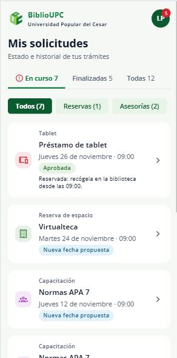

## 4. Personal de la biblioteca

Al iniciar sesión con una cuenta del personal, abajo aparecen las pestañas **Dashboard**, **Gestión**, **Personal**, **Inventario** y **Estadísticas**. Cada persona ve solo lo que le corresponde a su rol. Para ver la aplicación como la comunidad, usa **Ver la vista de la comunidad** en el menú de arriba a la derecha.

La primera vez que alguien del personal entra en el celular, Upecito le muestra su vista: **Gestión**, con las secciones que tiene, y, según su rol, **Personal**, **Inventario** y **Estadísticas**, además del menú. Cada paso dice en qué pestaña está. Para verlo otra vez, desde la vista del personal, toca el botón de arriba a la derecha y elige **Ver tutorial**.

### Gestión

1. **Solicitudes:** las solicitudes que llegan de la comunidad. Arriba, el selector **Reservas · Capacitaciones** elige cuáles ver.
   - Toca **Aprobar** para aceptar una.
   - Toca **Rechazar** para negarla; pide el motivo.
   - Toca **Otra fecha** para proponer otro día u hora.
   - En una capacitación aprobada, toca **Asignarme** o **Asignar responsable** para elegir quién la dicta y, cuando se haga, **Marcar como realizada**.
   - El botón **Reservar para un tercero** reserva un espacio a nombre de otra persona.
2. **Agenda:** las citas de asesoría por día, por semana y por mes. Las que esperan respuesta se ven como **Pendiente**, y desde el detalle de la cita se **aprueban** o se **rechazan** con un motivo; rechazarla libera el cupo de esa franja. Desde una cita del día se puede **Tomar asistencia**: la aplicación muestra un código QR para la sesión y el facilitador marca a mano a quien asistió. Quien asiste también puede registrarse escaneando ese QR desde su aplicación.
3. **Préstamos:** la entrega y la devolución de tablets, también leyendo el código de barras con la cámara.
4. **Vencidos:** las tablets que no se devolvieron a tiempo.
5. **Espacios:** crear y editar espacios, y bloquearlos por mantenimiento o eventos.
6. **Portal:**
   - **Contenidos del portal:** los avisos, novedades y servicios que ve la comunidad.
   - **Parámetros generales:** periodos académicos, festivos, horarios de atención, tiempos mínimos para solicitar y cancelar, y textos automáticos.
   - **Asesorías y jornadas:** los temas y los horarios de cada facilitador.
   - **Líneas de formación:** las capacitaciones que se ofrecen.

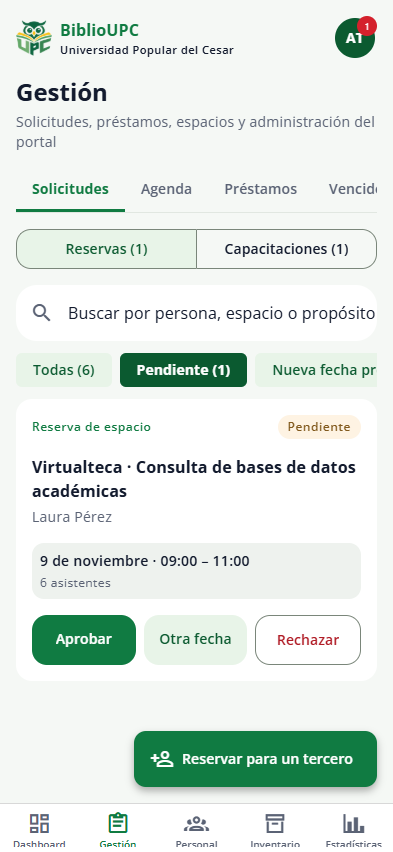
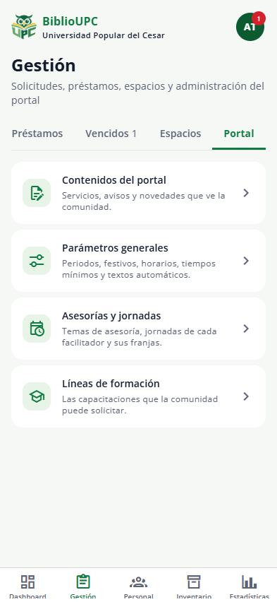

### Inventario

**Tablets** muestra cuántas tablets hay **Disponibles**, **En préstamo** y en **Mantenimiento**, y cada tablet con su estado. Desde la tarjeta de cada una se envía **A mantenimiento** y luego se vuelve a **Marcar disponible**.

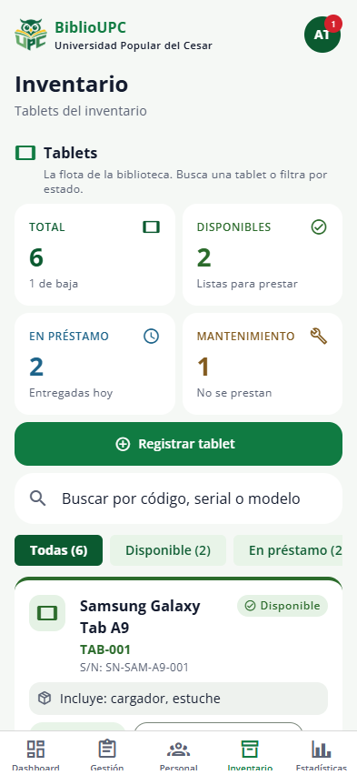

### Estadísticas

1. **Indicadores:** el total de operaciones y gráficos por servicio, mes, programa y tipo de usuario.
   - Se puede filtrar por periodo, servicio, tipo de usuario y programa.
   - **Exportar CSV** genera un archivo que se abre en Excel y lo comparte por correo, WhatsApp o Drive.
2. **Registros:** cada operación registrada, con quién la hizo, para qué, cuándo y cómo terminó. Lo que la persona no informó dice "No informado".

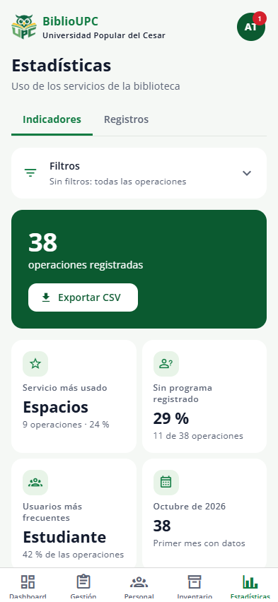
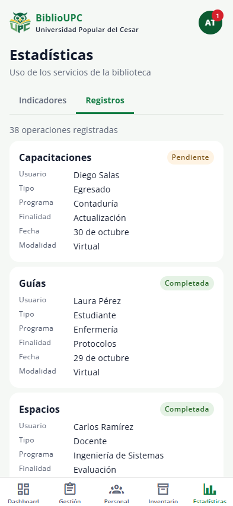

### Qué ve cada rol

- **Administración de la biblioteca:** todo, incluidas la pestaña **Personal** para asignar roles, **Parámetros generales**, y **Préstamos**, **Vencidos** e **Inventario** de tablets.
- **Facilitador:** las solicitudes de capacitación y la **Agenda** de sus asesorías.
- **Gestora de espacios:** las solicitudes de reserva y la sección **Espacios**, con sus bloqueos.

## 5. Usuarios de prueba

Todos entran con la contraseña **`biblioteca123`**. Basta con escribir el usuario: la aplicación completa el correo institucional.

| Usuario | Nombre | Tipo de usuario | Rol en la biblioteca |
|---|---|---|---|
| `laura.perez` | Laura Pérez | Estudiante | — |
| `carlos.ramirez` | Carlos Ramírez | Docente | — |
| `ana.torres` | Ana Torres | Administrativo | Administración de la biblioteca |
| `julian.mendoza` | Julián Mendoza | Administrativo | Facilitador |
| `sofia.vargas` | Sofía Vargas | Administrativo | Gestora de espacios |
| `mateo.castro` | Mateo Castro | Egresado | — |

## 6. Limitaciones de esta versión

- **Datos de prueba:** todavía no está conectada a los sistemas de la Universidad. Las personas, solicitudes y estadísticas son de ejemplo, y lo que se cambia se borra al cerrar la aplicación.
- **Solo Android:** por ahora no hay versión para iPhone.
- **Notificaciones y cámara:** los recordatorios y la lectura de códigos QR y de barras funcionan solo en el celular.
